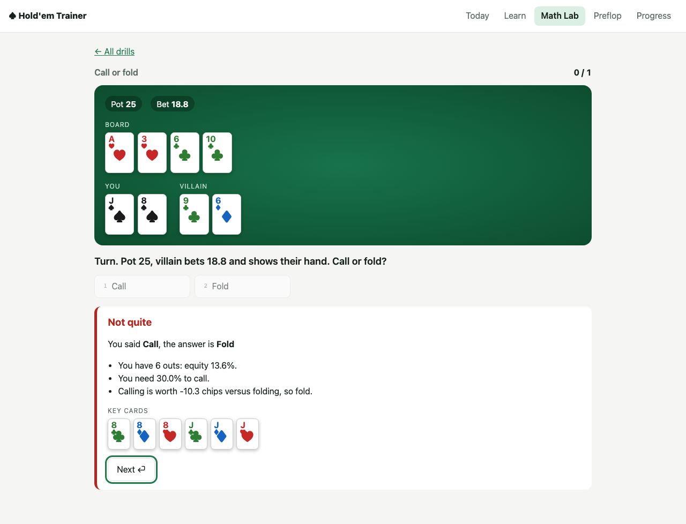
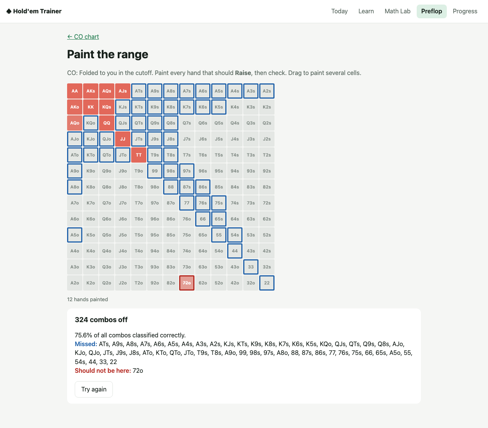
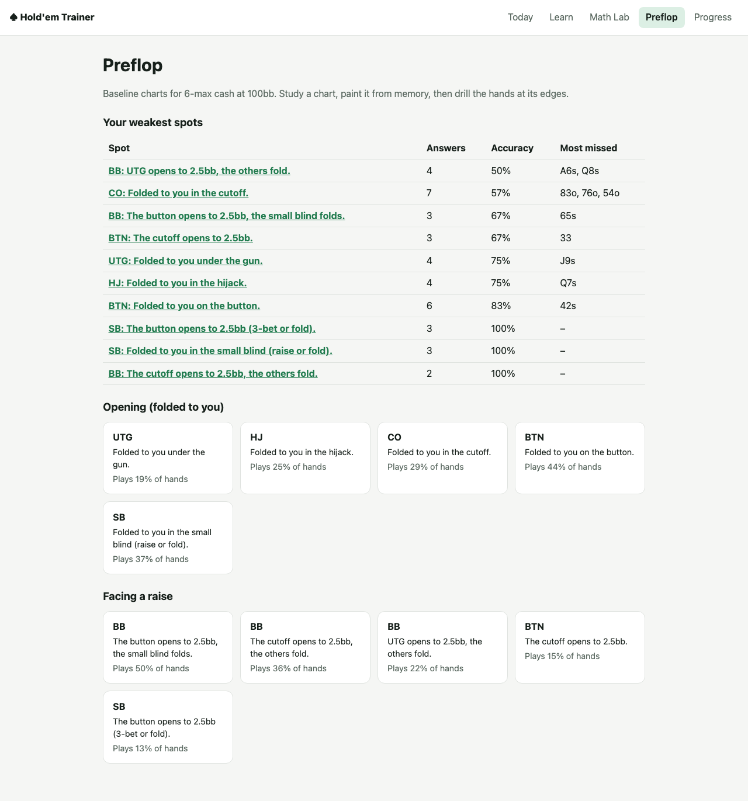
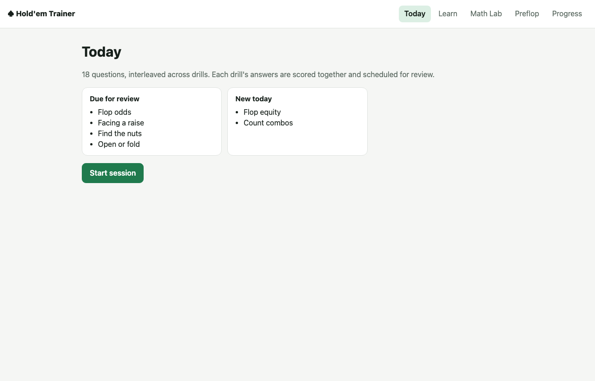
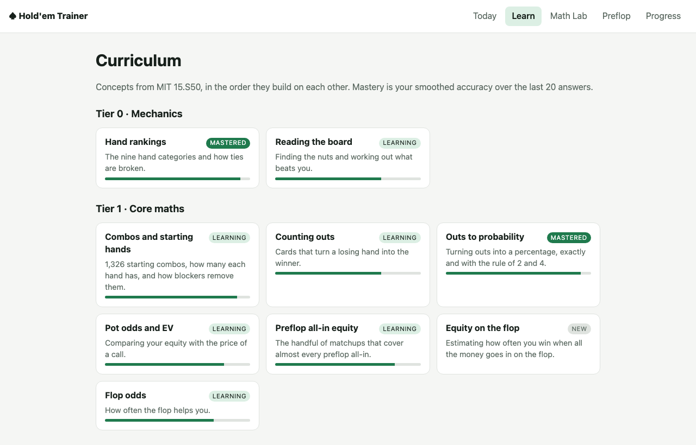
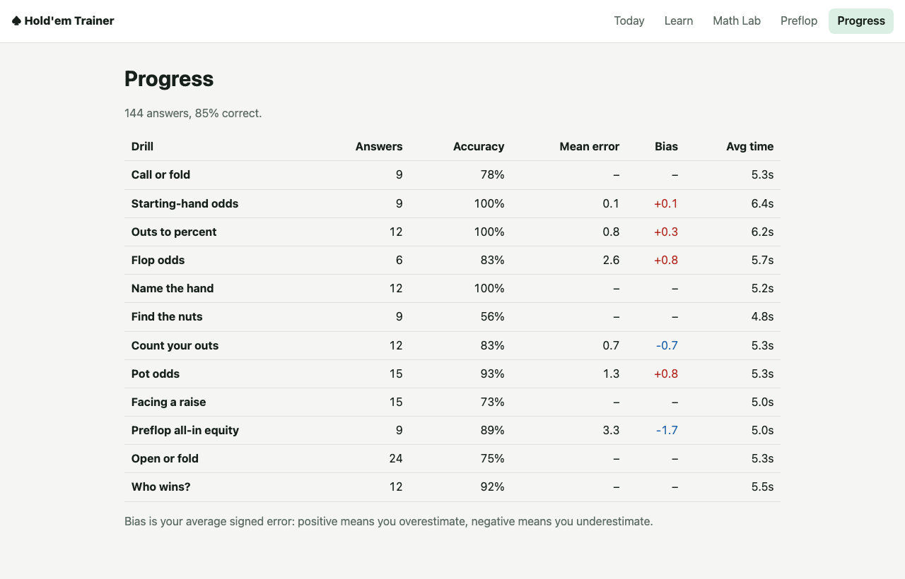
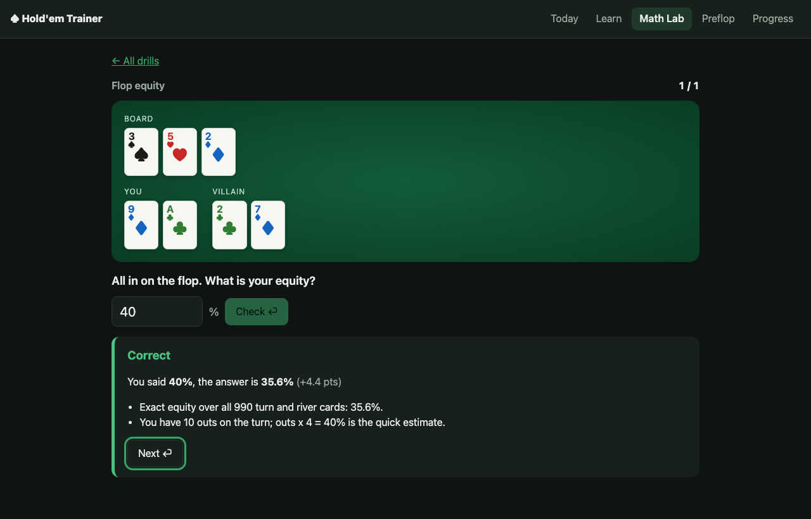
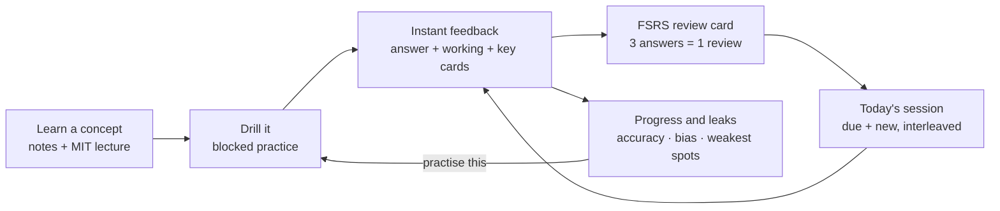
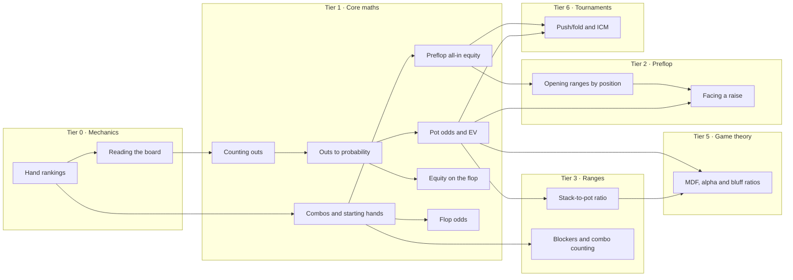
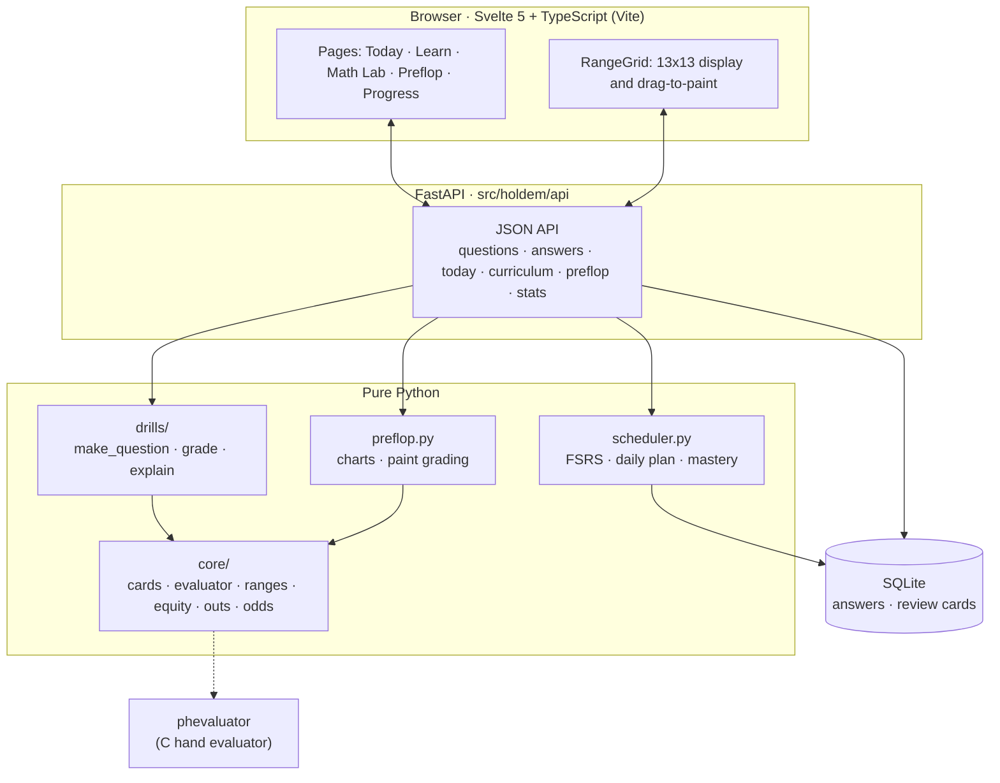

# ♠ Winning Texas Hold'em

**A local, interactive trainer for No-Limit Texas Hold'em.** Drill the maths until it is automatic,
learn preflop charts by painting them from memory, and let spaced repetition bring each skill back
just before you forget it. Built around MIT's
[15.S50 *How to Win at Texas Hold'em*](https://ocw.mit.edu/courses/15-s50-how-to-win-at-texas-holdem-poker-january-iap-2016/).


<p align="center">
  
</p>

Every number the app shows is computed by its own engine (exact enumeration where it is feasible,
seeded Monte Carlo otherwise), and every graded answer comes with the working, not just a verdict.

---

## Contents

- [What you can do](#what-you-can-do)
- [How it teaches](#how-it-teaches)
- [Curriculum map](#curriculum-map)
- [Architecture](#architecture)
- [Getting started](#getting-started)
- [Testing](#testing)
- [Roadmap](#roadmap)
- [Sources and caveats](#sources-and-caveats)

## What you can do

### Math Lab: the numbers behind every decision

Fourteen fast, keyboard-driven drills: hand rankings, reading the board, outs, outs to percent,
pot odds, call or fold, preflop and flop equity, starting-hand odds, flop odds, combos and
blockers, stack-to-pot ratio, and MDF / alpha / bluff ratios.

<table>
  <tr>
    <td width="50%"></td>
    <td width="50%"></td>
  </tr>
  <tr>
    <td><b>Call or fold.</b> Your equity against the price, and what the call is worth in chips.</td>
    <td><b>Count your outs.</b> The exact out cards, plus the tainted ones that improve you but still lose.</td>
  </tr>
</table>

### Preflop: charts you can actually remember

Opening ranges for every 6-max seat and defending ranges against opens, at 100bb. Drills sample
mostly hands **near the edge of a range**, because AA and 72o teach nothing. After each answer the
full chart appears with your hand outlined.

<table>
  <tr>
    <td width="50%"></td>
    <td width="50%"></td>
  </tr>
  <tr>
    <td><b>Spot drills</b> reveal the chart and the reasoning for the seat.</td>
    <td><b>Paint the range</b> from memory (drag with mouse or finger), then see what you missed, scored in combos.</td>
  </tr>
</table>



The Preflop page ranks your **weakest spots** and the hands you miss most in each, so you know
exactly what to drill next.

### Today: a daily session that schedules itself

<table>
  <tr>
    <td width="50%"></td>
    <td width="50%"></td>
  </tr>
  <tr>
    <td><b>Today</b> mixes drills that are due with a couple of new ones, interleaved.</td>
    <td><b>Learn</b> shows each concept's study notes, lecture links and your mastery.</td>
  </tr>
</table>

### Progress: where your estimates go wrong



Besides accuracy and speed, every numeric drill tracks your **bias**: the average signed error.
"You underestimate preflop equity by 1.7 points" is more useful than "you got it wrong".

<details>
<summary>Dark mode</summary>



</details>

## How it teaches

The design follows the learning-science results that hold up best: retrieval practice, spacing,
interleaving and immediate, explained feedback.



- **Spaced repetition.** Each drill has an [FSRS](https://github.com/open-spaced-repetition/py-fsrs)
  card. Once it is due, your next three answers for that drill are graded together into one review:
  3/3 is *good* (or *hard* if slow), 2/3 *hard*, otherwise *again*. Bursts of quick answers cannot
  inflate the interval.
- **Prerequisites.** New drills unlock in curriculum order, and a drill introduced today unlocks
  its follow-ups in the same session.
- **Interleaving.** Daily sessions go round-robin (A B C A B C …) instead of blocks of one drill.
- **Honest sources.** Exact maths, baseline charts and (later) heuristic advice are labelled as
  such in the UI.

## Curriculum map

Concepts and their prerequisites, generated from
[`src/holdem/curriculum.py`](src/holdem/curriculum.py). Tier 4 (postflop play) arrives with the
bot table.



## Architecture

All poker logic lives in a pure Python package with no web imports; the browser only renders and
collects input.



| Layer | Choice |
|---|---|
| Hand evaluation | [`phevaluator`](https://github.com/HenryRLee/PokerHandEvaluator), about 2.6M seven-card evaluations per second from Python |
| Equity | Exact enumeration on the flop and turn and for preflop hand-vs-hand; seeded Monte Carlo for preflop ranges and multiway |
| Scheduling | [`fsrs`](https://github.com/open-spaced-repetition/py-fsrs) (FSRS-6) |
| Server and storage | FastAPI, SQLAlchemy 2, SQLite |
| Front end | Svelte 5 runes, TypeScript, Vite; cards drawn in CSS with a four-colour deck |

## Getting started

You need [uv](https://docs.astral.sh/uv/) and Node.js (`brew install uv node` on macOS).

```sh
git clone https://github.com/kligvasser/winning-texas-holdem.git
cd winning-texas-holdem
cd web && npm install && npm run build && cd ..
uv run python -m holdem            # then open http://127.0.0.1:8000
```

Your answers are stored in `data/holdem.sqlite` (set `HOLDEM_DATA_DIR` to move it).

**Front-end development:** run `uv run python -m holdem --reload` and, in `web/`, `npm run dev`
(Vite proxies `/api` to the Python server).

**Demo data:** `uv run python scripts/seed_demo.py data/demo` creates a ten-day practice history;
start the app with `HOLDEM_DATA_DIR=data/demo` to explore the progress pages.

## Testing

```sh
uv run pytest -n 8                 # Python; fails below 100% line and branch coverage
uv run ruff check src tests && uv run pyright
cd web
npm run coverage                   # Vitest component and unit tests with coverage gates
npm run check                      # svelte-check and TypeScript
npm run e2e                        # Playwright against the real backend, desktop and phone
npm run screenshots                # regenerate the images in this README
```

- **Reference numbers are test fixtures.** The engine must reproduce the published 5-card hand
  frequencies, the outs table, the bet-size table (pot odds, MDF, alpha, bluff ratios), flop
  texture frequencies and 16 classic preflop all-in matchups by exhaustive enumeration.
- **Study notes are tested too.** Equity figures quoted in the curriculum are recomputed by the
  engine, so the notes cannot drift from the maths.
- **Coverage gates:** Python 100% line and branch; TypeScript modules 100%; Svelte components
  100% lines, statements and functions. Svelte branch coverage is gated at 85% because the
  compiler wraps every template value in `?? ""` and v8 counts each one as a branch.

## Roadmap

- [x] **Engine:** cards, evaluation, ranges, exact and Monte Carlo equity, outs, board texture, odds
- [x] **Math Lab:** 14 drills with explanations, answer log, per-drill stats and bias
- [x] **Scheduler and curriculum:** FSRS reviews, daily session, prerequisites, Learn pages
- [x] **Preflop trainer:** baseline charts, edge-weighted spot drills, paint-the-range, leak report
- [ ] **Play and review:** 6-max table against bot archetypes (nit, TAG, LAG, calling station, maniac), hand histories, review sorted by biggest mistake
- [ ] **Ranges and postflop:** range vs board, range advantage, hand-reading drill scored against the bot's true range
- [ ] **Tournaments and toy games:** push/fold Nash trainer, ICM quiz, the MIT problem-set betting game
- [ ] **Solver reference (optional):** offline heads-up flop solutions for postflop grading

## Sources and caveats

- **Course:** MIT OpenCourseWare 15.S50,
  [2016 (Will Ma)](https://ocw.mit.edu/courses/15-s50-how-to-win-at-texas-holdem-poker-january-iap-2016/)
  and [2015 (Kevin Desmond)](https://ocw.mit.edu/courses/15-s50-poker-theory-and-analytics-january-iap-2015/).
  Lecture links in the app point there.
- **Preflop charts are a self-authored baseline, not solver output.** They are shaped like modern
  charts and tested for sanity (opening ranges widen towards the button and nest inside each other),
  and every screen that shows them says so. Swap in charts you trust in
  [`src/holdem/preflop.py`](src/holdem/preflop.py).
- **For study only.** This is a training tool for play money and study, not an assistant for live
  play on poker sites.
