# ♠ Winning Texas Hold'em

**A local, interactive trainer for No-Limit Texas Hold'em.** Drill the maths until it is automatic,
learn preflop charts by painting them from memory, and let spaced repetition bring each skill back
just before you forget it. Built around MIT's
[15.S50 *How to Win at Texas Hold'em*](https://ocw.mit.edu/courses/15-s50-how-to-win-at-texas-holdem-poker-january-iap-2016/).


<p align="center">
  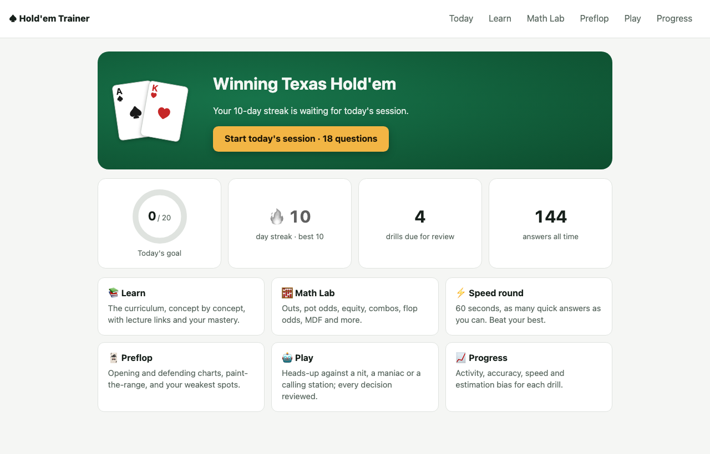
</p>

Every number the app shows is computed by its own engine (exact enumeration where it is feasible,
seeded Monte Carlo otherwise), and every graded answer comes with the working, not just a verdict.

---

## Contents

- [What you can do](#what-you-can-do)
- [How it teaches](#how-it-teaches)
- [Curriculum map](#curriculum-map)
- [Architecture](#architecture)
- [Getting started](#getting-started)
- [Testing](#testing)
- [Roadmap](#roadmap)
- [Sources and caveats](#sources-and-caveats)

## What you can do

### Built to be played every day

- **Daily streak and goal.** The home dashboard shows your streak (it greys out until you practise
  today), a 20-answer goal ring, how many drills are due, and a one-click start.
- **Combos.** Two correct answers in a row light up a 🔥 counter; the session summary records your
  best streak.
- **Fast, keyboard-first flow.** Cards deal in, the next question is fetched while you read the
  explanation, Enter checks and moves on, 1–9 pick a choice, S skips.
- **Forgiving input.** `25`, `25%`, `0,25` and `1/4` all work; anything else gets a hint instead
  of silence.
- **Sessions survive reloads.** Leave a daily session half way and resume it later the same day.

<table>
  <tr>
    <td width="50%">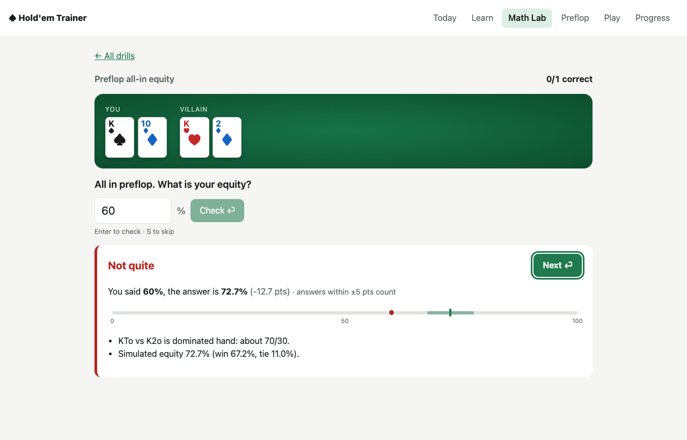</td>
    <td width="50%">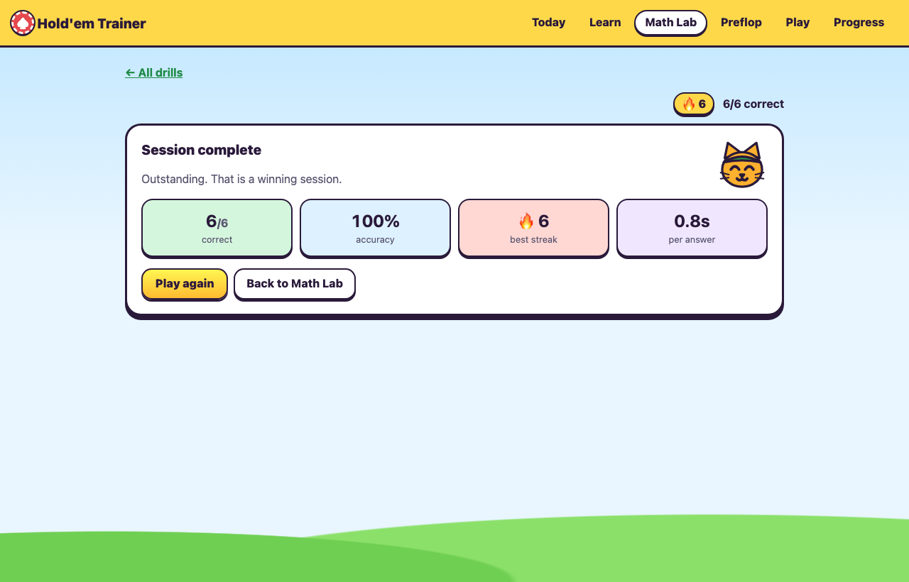</td>
  </tr>
  <tr>
    <td><b>Closeness meter.</b> Every percentage answer shows your estimate against the truth and the accepted band.</td>
    <td><b>Session summary.</b> Score, accuracy, best streak and speed, with confetti for a strong session.</td>
  </tr>
</table>

### Training inventory

28 drills plus paint-the-range across all seven tiers. Every answer is computed by the engine from the assumptions stated in the question.

| Tier | Drills |
|---|---|
| 0 · Mechanics | Name the hand · Who wins? · Find the nuts |
| 1 · Core maths | Count your outs · Outs to percent · Pot odds · Call or fold · Preflop all-in equity · Flop equity · Starting-hand odds · Flop odds |
| 2 · Preflop | Open or fold · Facing a raise · Paint the range |
| 3 · Ranges | Equity vs a range · How often does the range hit? · Implied odds · Count combos (blockers) · Stack-to-pot ratio |
| 4 · Postflop | Read the bot's range (hand reading) · Bluff EV (pure and semi-bluffs) · **Hand stories**: the flush draw, set-mining, top pair under pressure, an overcard in a 3-bet pot |
| 5 · Game theory | MDF, alpha and bluff ratios · Bluff-catching |
| 6 · Tournaments | Shove or fold (push/fold EV) · ICM: what are your chips worth? |

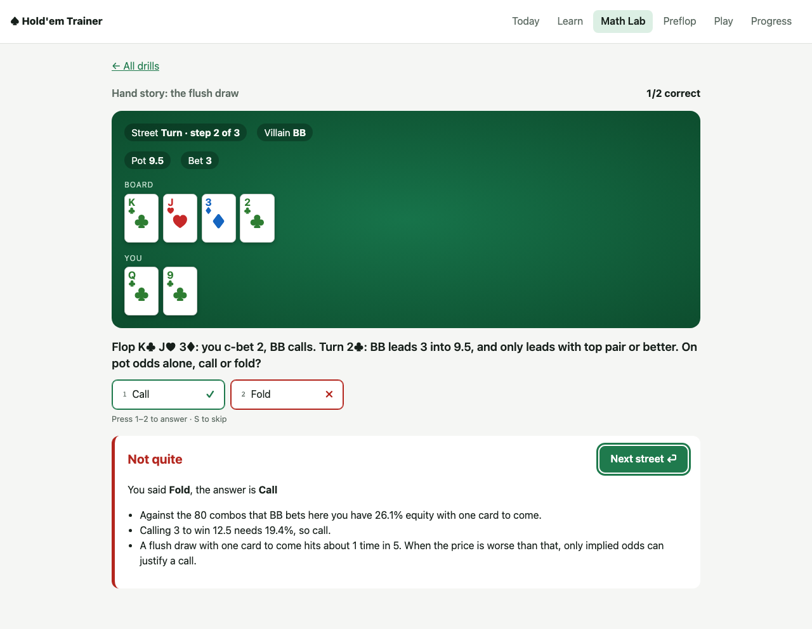

**Hand stories** play one hand street by street. Each decision is graded by exact equity against
the villain's stated range, and at the end you see the hand the villain actually held. Stories are
data, so you can write your own (see [Writing a hand story](#writing-a-hand-story)).

### Play against bots, then review every decision

Heads-up at 100bb against an opponent with a clear style: **nit**, **TAG**, **LAG**, **calling
station** or **maniac**. Turn on the coach to see the price and your equity against the bot's likely
range. After each hand every call and fold you made is graded against that range and costed in big
blinds; the Review page lists your hands worst mistake first, with your VPIP, PFR and bb/100.

<table>
  <tr>
    <td width="50%">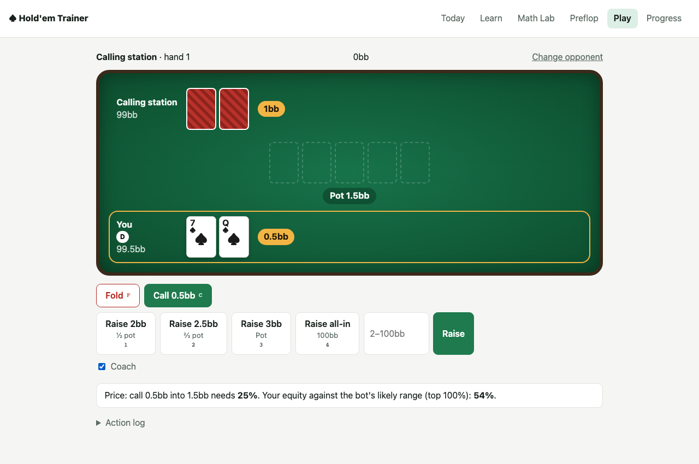</td>
    <td width="50%">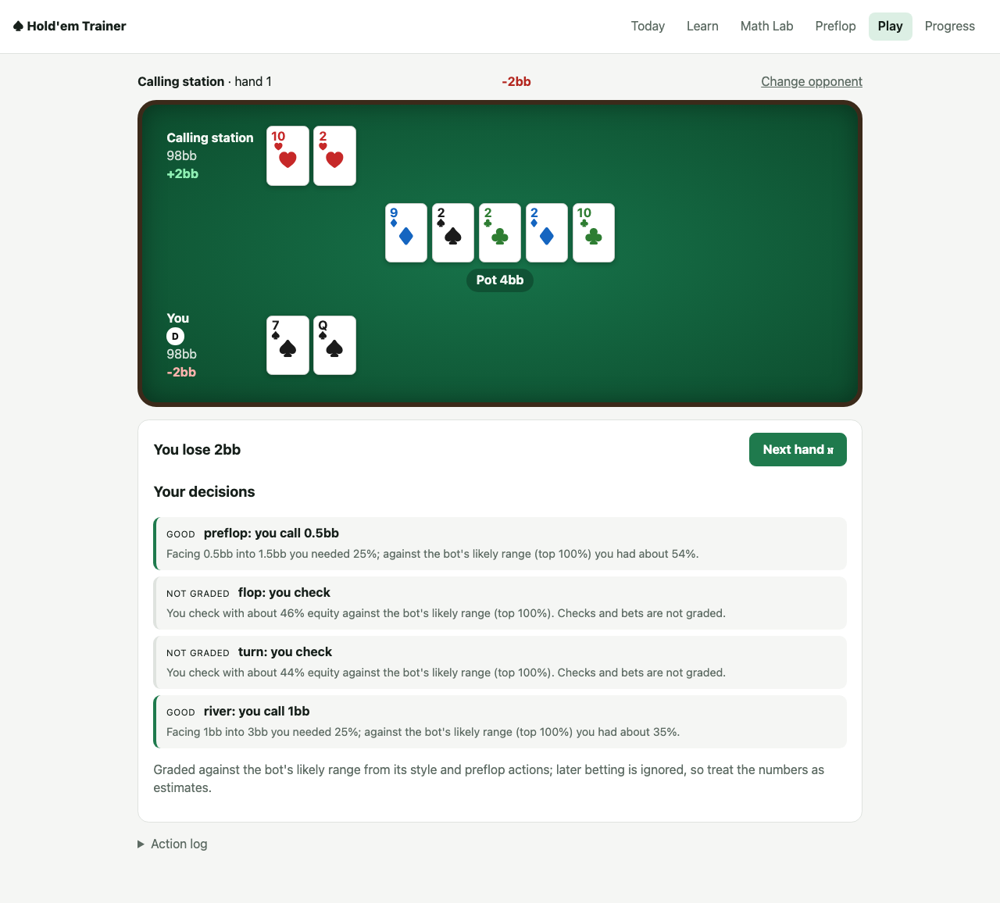</td>
  </tr>
  <tr>
    <td><b>The table.</b> Bet presets (½ pot, ⅔, pot, all-in) and keyboard play: F fold, C check or call, 1–5 sizes, N next hand.</td>
    <td><b>The review.</b> Graded by equity against the bot's preflop range, so treat it as an estimate: later betting is not modelled.</td>
  </tr>
</table>

### Hand reading, graded against the truth

Watch a hand between a styled bot and an autopilot holding your cards, and after every street
narrow the bot's range on the 13×13 grid (it starts full; remove what its actions rule out, and
your range carries to the next street). Because the bots' strategies are known exactly, the app
knows the bot's **real** range: every hand weighted by how likely the bot was to play it exactly
this way. Your score is how much your range overlaps it: painting too wide or too narrow both cost
you. The feedback shows the real range as a heat map, the best score any range could reach, the
likely hands you removed, the unlikely ones you kept, and finally the hand the bot actually held.

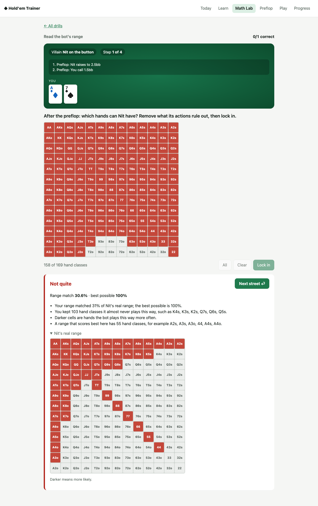

### Speed rounds

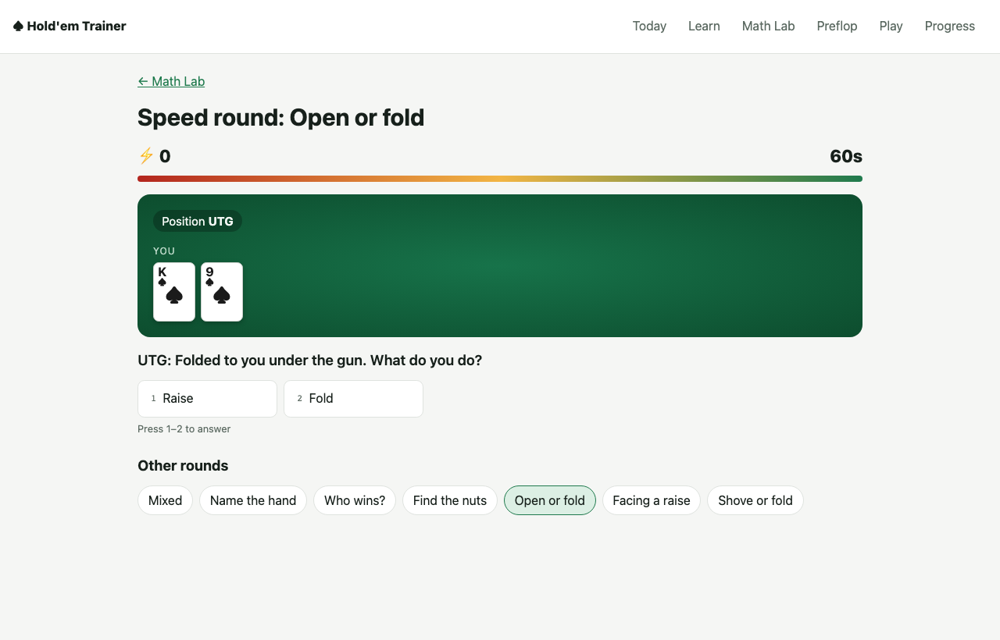

Sixty seconds on the quick multiple-choice drills (name the hand, who wins, find the nuts, open or
fold, facing a raise, shove or fold). Correct answers move on instantly; your personal best is kept
per round.

### Math Lab: the numbers behind every decision

Fast, keyboard-driven drills on outs, pot odds, equity, combos, flop odds, SPR, MDF and bluff ratios.

<table>
  <tr>
    <td width="50%"></td>
    <td width="50%">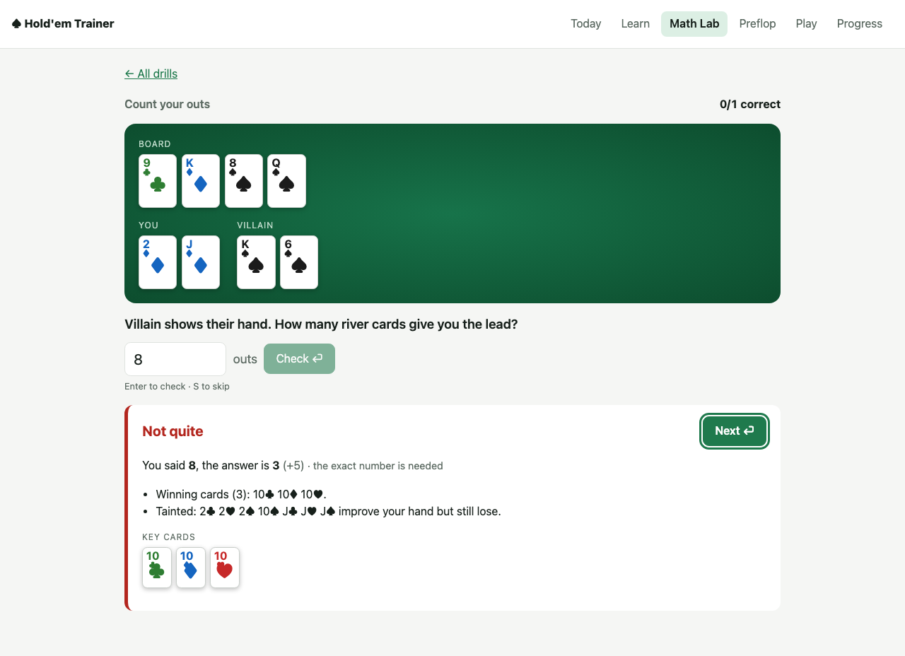</td>
  </tr>
  <tr>
    <td><b>Call or fold.</b> Your equity against the price (split pots included), and what the call is worth in chips.</td>
    <td><b>Count your outs.</b> The exact out cards, plus tainted ones: cards that improve your own hand but still lose.</td>
  </tr>
</table>

### Preflop: charts you can actually remember

Opening ranges for every 6-max seat and defending ranges against opens, at 100bb. Drills sample
mostly hands **near the edge of a range**, because AA and 72o teach nothing. After each answer the
full chart appears with your hand outlined.

<table>
  <tr>
    <td width="50%">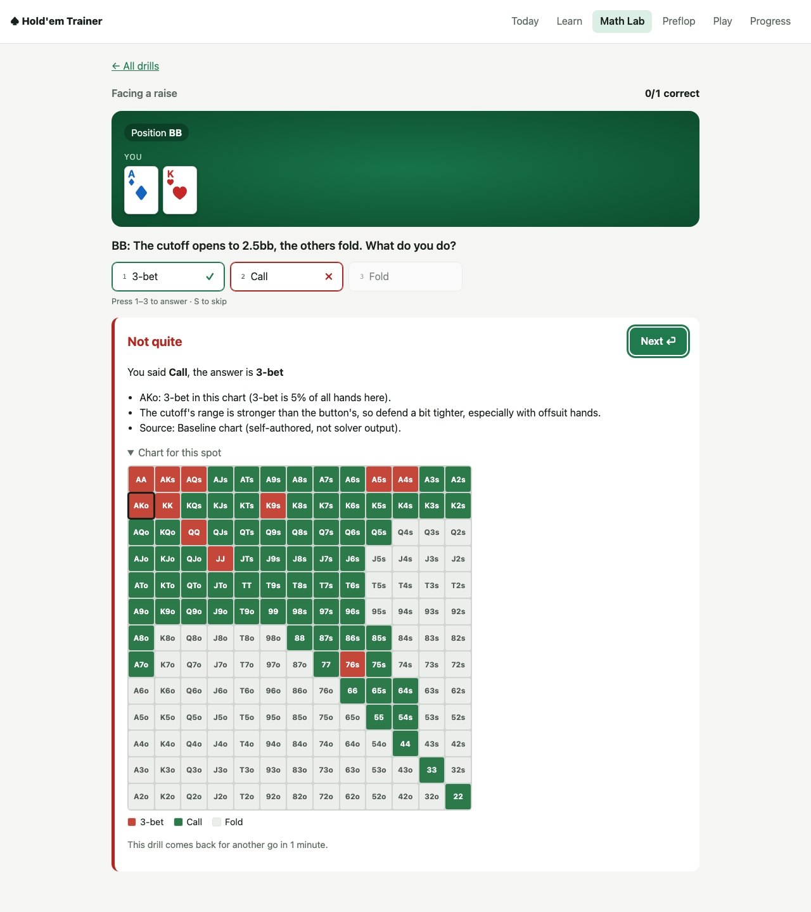</td>
    <td width="50%"></td>
  </tr>
  <tr>
    <td><b>Spot drills</b> reveal the chart and the reasoning for the seat.</td>
    <td><b>Paint the range</b> from memory (drag with mouse or finger), then see what you missed, scored in combos.</td>
  </tr>
</table>


The Preflop page lists your **weakest spots** (below 80%) and the hands you miss most in each. Painting
works with a mouse drag, a finger tap (swipes still scroll the page) or the keyboard (arrow keys move,
Enter toggles).

### Today: a daily session that schedules itself

<table>
  <tr>
    <td width="50%"></td>
    <td width="50%"></td>
  </tr>
  <tr>
    <td><b>Today</b> mixes drills that are due with a couple of new ones, interleaved.</td>
    <td><b>Learn</b> shows each concept's study notes, lecture links and your mastery.</td>
  </tr>
</table>

### Progress: where your estimates go wrong


A 12-week activity heatmap, streak tiles, and every drill sorted weakest first with an accuracy bar.
Besides accuracy and speed, every numeric drill tracks your **bias**: the average signed error.
"You underestimate preflop equity by 1.7 points" is more useful than "you got it wrong". Click any
drill to practise it.

<details>
<summary>Dark mode</summary>


</details>

## How it teaches

The design follows the learning-science results that hold up best: retrieval practice, spacing,
interleaving and immediate, explained feedback.

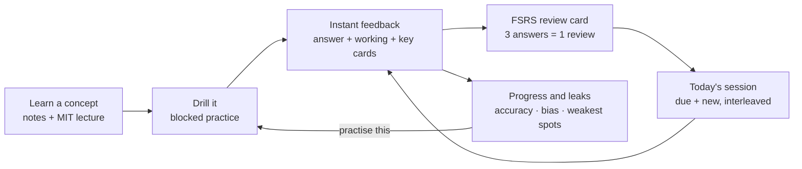

- **Spaced repetition.** Each drill has an [FSRS](https://github.com/open-spaced-repetition/py-fsrs)
  card. Once it is due, your next three answers for that drill are graded together into one review:
  3/3 is *good* (or *hard* if slow), 2/3 *hard*, otherwise *again*. Bursts of quick answers cannot
  inflate the interval.
- **Prerequisites.** New drills unlock in curriculum order, and a drill introduced today unlocks
  its follow-ups in the same session.
- **Interleaving.** Daily sessions go round-robin (A B C A B C …) instead of blocks of one drill.
- **Honest sources.** Exact maths, baseline charts and (later) heuristic advice are labelled as
  such in the UI.

## Curriculum map

Concepts and their prerequisites, generated from
[`src/holdem/curriculum.py`](src/holdem/curriculum.py).

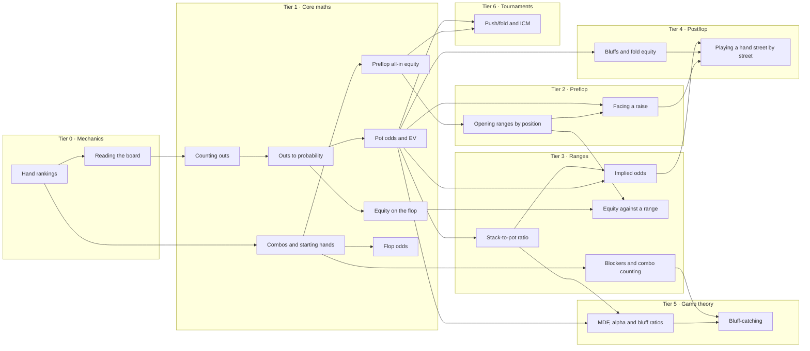

## Writing a hand story

Stories live in [`src/holdem/data/stories`](src/holdem/data/stories) as TOML and need no code. A
story names the hero's hands, the villain's range from a baseline chart, and a list of steps:

```toml
key = "story-set-mining"
title = "Hand story: set-mining"
description = "Defend the big blind with a small pair, flop a set, and get paid."
pot = 5.5                                     # pot after the preflop action, in bb

[hero]
classes = "22-99"

[villain]
name = "BTN"
spot = "btn-open"                             # a baseline chart and the action in it
action = "Raise"

[[steps]]
street = "preflop"
decision = "chart"                            # graded by the chart
spot = "bb-vs-btn"
expect = "Call"                               # only hero hands the chart plays this way
prompt = "The button opens. You are in the big blind with {hand}. 3-bet, call or fold?"

[[steps]]
street = "flop"
hero = ["set"]                                # conditions on the hero's hand (all must hold)
board = ["unpaired"]                          # conditions on the new cards: unpaired, blank
decision = "call"                             # call, catch, bluff or value
size = [0.33, 0.5]                            # bet as a share of the pot, one picked at random
prompt = "Flop {flop}: BTN bets {bet} into {pot}. Call or fold?"
lesson = "With a set you are far ahead; calling keeps the bluffs in."
```

| Decision | You choose | Graded by |
|---|---|---|
| `chart` | the chart's actions | the baseline preflop chart |
| `call` | call or fold | equity against the villain's current range vs the price |
| `catch` | call or fold | the same, against the hands listed in `bets` |
| `bluff` | bet or check | share of the range in `folds` vs the bluff's break-even |
| `value` | bet or check | equity against the hands in `calls`: bet when above 50% |

Conditions: `set`, `overpair`, `underpair_to_top`, `top_pair`, `top_pair_plus`, `two_pair_plus`,
`pair_plus`, `one_pair`, `weak_pair`, `flush_draw`, `oesd`, `draw`, `nothing`; prefix `not_` to
negate. A step's `villain` list narrows the villain's range (a hand stays if *any* condition holds).
Placeholders: `{hand}`, `{villain}`, `{flop}`, `{turn}`, `{river}`, `{pot}`, `{bet}`, `{setup_bet}`.
Tests deal every story many times and check that each step is graded and every placeholder filled.

## Architecture

All poker logic lives in a pure Python package with no web imports; the browser only renders and
collects input.

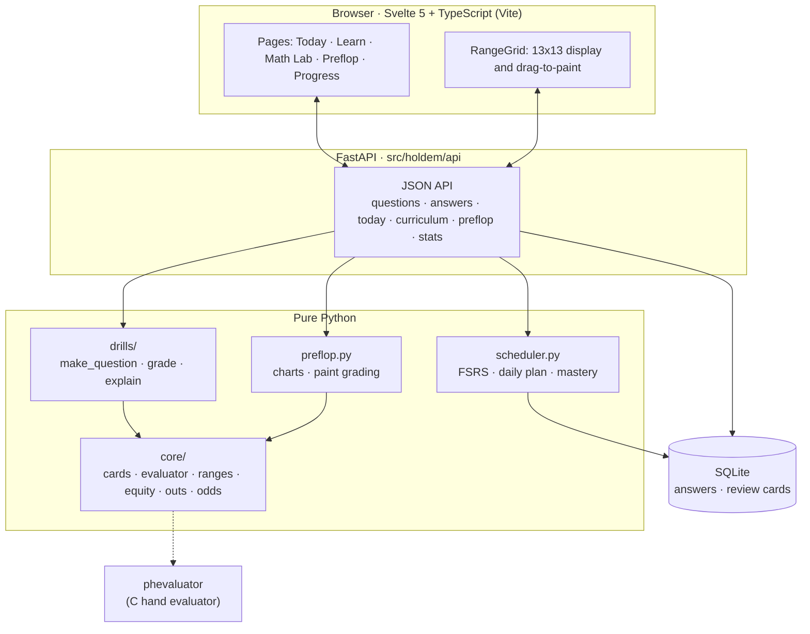

| Layer | Choice |
|---|---|
| Hand evaluation | [`phevaluator`](https://github.com/HenryRLee/PokerHandEvaluator), about 2.6M seven-card evaluations per second from Python |
| Equity | Exact enumeration on the flop and turn and for preflop hand-vs-hand; seeded Monte Carlo for preflop ranges and multiway |
| Scheduling | [`fsrs`](https://github.com/open-spaced-repetition/py-fsrs) (FSRS-6) |
| Server and storage | FastAPI, SQLAlchemy 2, SQLite |
| Front end | Svelte 5 runes, TypeScript, Vite; cards drawn in CSS with a four-colour deck |

## Getting started

You need [uv](https://docs.astral.sh/uv/) and Node.js (`brew install uv node` on macOS).

```sh
git clone https://github.com/kligvasser/winning-texas-holdem.git
cd winning-texas-holdem
cd web && npm install && npm run build && cd ..
uv run python -m holdem            # then open http://127.0.0.1:8000
```

Your answers are stored in `data/holdem.sqlite` (set `HOLDEM_DATA_DIR` to move it).

**Front-end development:** run `uv run python -m holdem --reload` and, in `web/`, `npm run dev`
(Vite proxies `/api` to the Python server).

**Demo data:** `uv run python scripts/seed_demo.py data/demo` creates a ten-day practice history;
start the app with `HOLDEM_DATA_DIR=data/demo` to explore the progress pages.

## Testing

```sh
uv run pytest -n 8                 # Python; fails below 100% line and branch coverage
uv run ruff check src tests && uv run pyright
cd web
npm run coverage                   # Vitest component and unit tests with coverage gates
npm run check                      # svelte-check and TypeScript
npm run e2e                        # Playwright against the real backend, desktop and phone
npm run screenshots                # regenerate the images in this README
```

- **Reference numbers are test fixtures.** The engine must reproduce the published 5-card hand
  frequencies, the outs table, the bet-size table (pot odds, MDF, alpha, bluff ratios), flop
  texture frequencies and 16 classic preflop all-in matchups by exhaustive enumeration.
- **Study notes are tested too.** Equity figures quoted in the curriculum are recomputed by the
  engine, so the notes cannot drift from the maths.
- **Coverage gates:** Python 100% line and branch; TypeScript modules 100%; Svelte components
  100% lines, statements and functions. Svelte branch coverage is gated at 85% because the
  compiler wraps every template value in `?? ""` and v8 counts each one as a branch.

## Roadmap

- [x] **Engine:** cards, evaluation, ranges, exact and Monte Carlo equity, outs, board texture, odds
- [x] **Math Lab:** 14 drills with explanations, answer log, per-drill stats and bias
- [x] **Scheduler and curriculum:** FSRS reviews, daily session, prerequisites, Learn pages
- [x] **Preflop trainer:** baseline charts, edge-weighted spot drills, paint-the-range, leak report
- [x] **Ranges, fold equity, tournaments:** equity vs ranges, range hits, implied odds, bluff EV, bluff-catching, push/fold EV, ICM, and a street-by-street hand story
- [x] **Hand stories as data:** a story engine and four stories (flush draw, set-mining, top pair under pressure, 3-bet pot)
- [x] **Speed rounds:** 60-second keyboard sprints on choice drills, with personal bests
- [x] **Play and review (heads-up):** five bot styles, a live coach, every call and fold graded and costed, hand history with VPIP/PFR/bb/100
- [ ] **6-max table:** more seats, side pots and position play against a mix of bot styles
- [x] **Hand reading:** narrow a bot's range street by street, scored against the bot's true range
- [ ] **Postflop-aware review:** narrow the bot's range by its postflop actions, and grade bets and raises
- [ ] **Toy games:** the MIT problem-set betting game and the AKQ game, playable against exploitable and optimal opponents
- [ ] **Push/fold Nash charts:** solve heads-up shove/call ranges locally and drill against them
- [ ] **Solver reference (optional):** offline heads-up flop solutions for postflop grading

## Sources and caveats

- **Course:** MIT OpenCourseWare 15.S50,
  [2016 (Will Ma)](https://ocw.mit.edu/courses/15-s50-how-to-win-at-texas-holdem-poker-january-iap-2016/)
  and [2015 (Kevin Desmond)](https://ocw.mit.edu/courses/15-s50-poker-theory-and-analytics-january-iap-2015/).
  Lecture links in the app point there.
- **Preflop charts are a self-authored baseline, not solver output.** They are shaped like modern
  charts and tested for sanity (opening ranges widen towards the button and nest inside each other),
  and every screen that shows them says so. Swap in charts you trust in
  [`src/holdem/preflop.py`](src/holdem/preflop.py).
- **For study only.** This is a training tool for play money and study, not an assistant for live
  play on poker sites.
